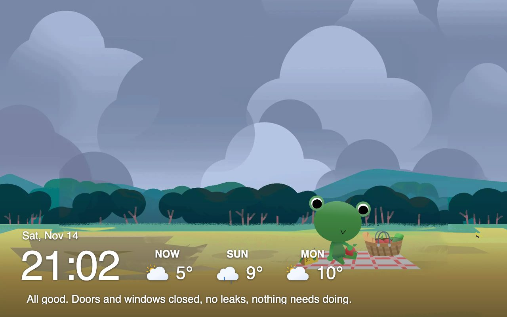
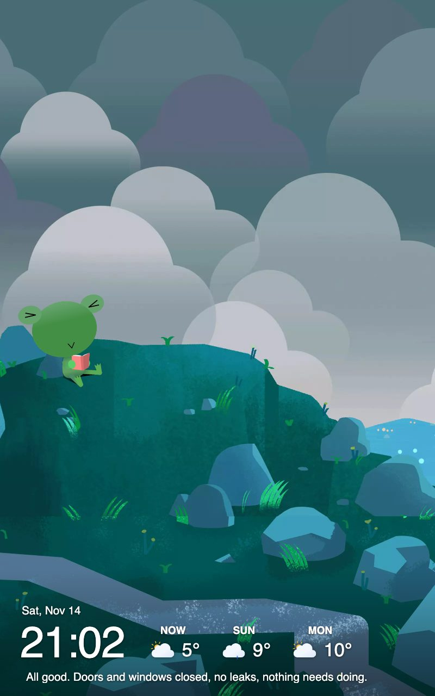

# Froggy Weather Card

An animated weather frog for your Home Assistant dashboards. The card shows the scene that matches
the current weather and time of day: the frog flies a kite on a sunny day, reads a book under the
clouds and looks through a telescope at night. It can also show a clock and a short forecast over
the scene, like a Google Nest Hub.

If you miss the weather frog since Google removed its animations, this card is a good replacement:
put it on a wall tablet, an old smart display or any Home Assistant dashboard and the frog is back.





> **Artwork notice.** The weather frog artwork (backgrounds and frog animations) was made by Google
> and copyright belongs to Google LLC. It is included here, as in the
> [Froggy](https://github.com/R0rt1z2/Froggy) project it comes from, for non-commercial personal use
> under the fair use doctrine. This project is not affiliated with, sponsored by or endorsed by
> Google. If you hold rights to the artwork and want it removed, please open an issue.

## Features

- 60 scenes: three landscapes (fields, hill, mushroom house), four times of day (morning, day,
  sunset, night) and five kinds of weather (sunny, cloudy, hazy, rainy, snowy), chosen from your
  weather entity and the sun.
- The frog plays its animation, rests for a few seconds and plays again, as on the original.
- Smooth on slow hardware: where the browser has no WebGL, as on many smart displays, each scene
  plays as a pre-rendered video at 30 frames per second instead, cut portrait, landscape or square
  to match the card's shape.
- Optional Nest Hub style overlay: date, large clock, now and the next days with colour weather
  icons. It can also show an optional status line from any sensor; it is off unless you set one.
- Everything is served by Home Assistant itself; the card makes no requests to other sites.
- Where video cannot play either, the frog is drawn in software, and where even that is impossible
  the card shows a still of the frog.
- Visual editor in the dashboard.

## Installation

### HACS

[](https://my.home-assistant.io/redirect/hacs_repository/?owner=drcursor&repository=froggy-weather-card&category=plugin)

The button opens this repository in HACS (the Marketplace) on your own Home Assistant; choose
**Download** and reload the browser. Or add it by hand:

1. In Home Assistant, open **HACS** (the **Marketplace** under Settings on Home Assistant 2026.11
   and later).
2. Add this repository as a custom repository, type **Dashboard**:
   `https://github.com/drcursor/froggy-weather-card`
3. Find **Froggy Weather Card** and download it.
4. Reload the browser.

HACS registers the dashboard resource for you. The download is about 85 MB, mostly the scene
videos (60 scenes, each cut three ways).

### Manual

1. Download all files attached to the [latest release](https://github.com/drcursor/froggy-weather-card/releases/latest)
   (or everything in `dist/`) into `/config/www/froggy-weather-card/`. Keep them in one folder.
2. Add a dashboard resource: **Settings > Dashboards > Resources > Add resource**, URL
   `/local/froggy-weather-card/froggy-weather-card.js`, type **JavaScript module**.
3. Reload the browser.

## Configuration

Add the card from the card picker, or in YAML:

```yaml
type: custom:froggy-weather-card
entity: weather.home
```

| Option | Default | Description |
|---|---|---|
| `entity` | first weather entity | The weather entity that picks the scene and fills the overlay. |
| `sun` | `sun.sun` | The sun entity that sets the time of day. |
| `scene` | `fields` | `fields`, `hill`, `mushroom`, or `random` (a new landscape each time the scene changes). |
| `show_weather` | `true` | Show weather over the scene. |
| `overlay` | `simple` | `simple`: temperature and condition. `nest`: date, clock, now and the next days. |
| `forecast_days` | `2` | Nest overlay: how many days after today to show. |
| `time_format` | from your profile | Nest overlay: `24` or `12` (12-hour times are shown without AM or PM, like the Nest Hub). |
| `icons` | `meteocons` | Nest overlay: `meteocons` (colour) or `mdi` (white Material Design icons). |
| `status_entity` | none (off) | Nest overlay: optional status line; a sensor whose text is shown on one line under the clock. |
| `status_ok_prefix` | `All good` | Status text starting with this shows a green check; anything else an orange alert. |
| `aspect_ratio` | `1` | Width divided by height of the card. |
| `full_height` | `false` | Fill the window below the card's top edge, for a panel view or a kiosk screen. |
| `height` | none | Any CSS height, such as `30vh`. Overrides `aspect_ratio` and `full_height`. |
| `focus_y` | `0.5` | When the square scene is cropped, which height stays in view, from `0` (top) to `1` (bottom). |
| `border_radius` | theme | Corner radius in pixels. |
| `video` | `auto` | Pre-rendered scene videos. `auto`: only where WebGL is missing or the live drawing fails. `always`: videos first on every device. `never`: always draw live. |
| `software_max_side` | `800` | Live drawing without WebGL: largest canvas side in pixels. Lower is smoother on slow devices. |
| `software_fps` | `30` | Live drawing without WebGL: frame rate cap. |

The clock and the forecast days always use Home Assistant's time zone, so a display whose browser
runs on UTC still shows the right time.

### Examples

A full-screen panel, like a Nest Hub:

```yaml
views:
  - title: Froggy
    type: panel
    cards:
      - type: custom:froggy-weather-card
        entity: weather.home
        overlay: nest
        full_height: true
        border_radius: 0
```

An optional status line under the clock, for example a template sensor that reads "All good" or
lists what needs attention (green check when the text starts with `status_ok_prefix`, orange
alert otherwise):

```yaml
type: custom:froggy-weather-card
entity: weather.home
overlay: nest
status_entity: sensor.house_status
status_ok_prefix: All good
```

A strip across the top of a dashboard:

```yaml
type: custom:froggy-weather-card
entity: weather.home
show_weather: false
height: 30vh
focus_y: 0.65
border_radius: 0
```

### Lenovo Smart Display with LANovo

[LANovo](https://github.com/ygelfand/LANovo) replaces Google Assistant on Lenovo Smart Displays (and
the JBL Link View and Lenovo ThinkSmart View) and can show a Home Assistant dashboard, which gives
these displays their frog back. Its built-in browser has no WebGL, so the card plays its scene
videos there (the 1200x1920 portrait cut fits the Lenovo Smart Display 10 exactly), and it shows
Home Assistant's time even though that browser runs on UTC.

1. Make a dashboard with the card, for example the full-screen panel above, or a kitchen layout
   with the frog across the top:

   ```yaml
   views:
     - title: Kitchen
       type: panel
       cards:
         - type: vertical-stack
           cards:
             - type: custom:froggy-weather-card
               entity: weather.home
               show_weather: false
               height: 30vh
               focus_y: 0.65
               border_radius: 0
             - type: weather-forecast
               entity: weather.home
               forecast_type: daily
             - type: grid
               columns: 4
               square: false
               cards:
                 - type: tile
                   entity: light.kitchen
                   vertical: true
                   tap_action:
                     action: toggle
                 - type: tile
                   entity: light.dining_table
                   vertical: true
                   tap_action:
                     action: toggle
   ```

2. In Home Assistant, follow LANovo's
   [dashboard setup](https://www.lanovo.link/use/dashboards/#home-assistant): allow a user in the
   integration's options, and allow the display to perform Home Assistant actions.
3. On the display, open **Settings > Dashboard**, set **Mode** to **HA**, and pick the user, the
   dashboard and the view.

Tips:

- LANovo hides Home Assistant's header, so `full_height: true` fills the whole screen.
- For a dark dashboard at night, set the display's **Theme** to a dark one (the
  `select.<display>_screen_theme` entity can do it from an automation, for example an hour after
  sunset) and set the Home Assistant user's dark mode to **Auto**: LANovo then switches the
  dashboard with its theme.

## How it works

The card tries these in order and uses the first that works:

1. The animation drawn live with WebGL (sharp at any size, the original animation).
2. A pre-rendered video of the scene, where WebGL is missing or the live drawing does not start.
3. The animation drawn live in software, where the video cannot play.
4. A still of the frog over the background.

`video: always` moves the video to the front; `video: never` leaves it out.

Each video is the background with the frog's animation, rendered from the original animation at
1920x1920 and 30 frames per second, and cut three ways (VP9 WebM):

| Cut | Size | Used when the card's width divided by its height is |
|---|---|---|
| `_portrait` | 1200x1920 | 0.63 or less (a portrait screen) |
| `_landscape` | 1920x1200 | 1.59 or more (a landscape screen, a wide strip) |
| `_square` | 1080x1080 | in between |

Each cut covers everything a card of that shape shows, so nothing is lost to cropping. The video
plays once, holds its last frame, and plays again after a few seconds, as the original does.

The frog animations are [Flare](https://github.com/2d-inc/Flare-JS) files. The card plays them
with Flare-JS 1.0.0 and CanvasKit, patched to read the newer Flare format that these files use and
to draw without WebGL. Layer effects (blur, shadows, masks) are read but not drawn, so a few soft
details look flatter than in the original. The patch is in `vendor/flare-js/flare-js.patch`.

## Building

`dist/` holds everything the card needs. To rebuild it (Node.js, npm and curl required):

```sh
build/build.sh
```

The script downloads Flare-JS 1.0.0 from npm, applies the patch, bundles it, and fetches the
artwork from the Froggy repository at a fixed commit. The scene videos in `vendor/videos/` are
rendered from that artwork by `build/render_videos.py` (Playwright with Chrome, and ffmpeg), and
the frog stills in `vendor/stills/` by `build/render_stills.py`.

To release, raise `CARD_VERSION` in `src/froggy-weather-card.js`, run the build, commit, and
publish a GitHub release tagged with the same version (for example `v1.0.1`). A workflow attaches
the files in `dist/` to the release, which is what HACS installs.

## Credits

- [Froggy](https://github.com/R0rt1z2/Froggy) by R0rt1z2, which gathered the artwork and the
  rules for choosing a scene.
- [Flare-JS](https://github.com/2d-inc/Flare-JS) by 2Dimensions and [CanvasKit](https://skia.org)
  by Google.
- [Meteocons](https://github.com/basmilius/meteocons) by Bas Milius.

## License

The code is under the MIT License. The artwork and the bundled components keep their own terms;
see [THIRD_PARTY_NOTICES.md](THIRD_PARTY_NOTICES.md).
